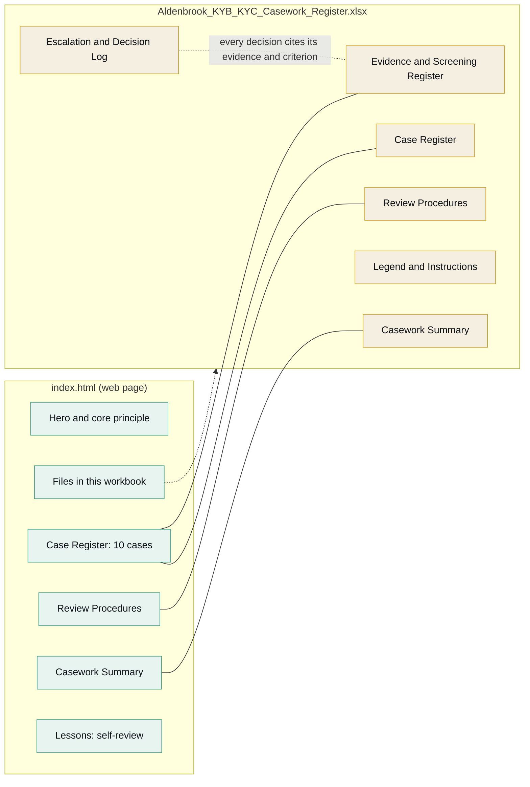
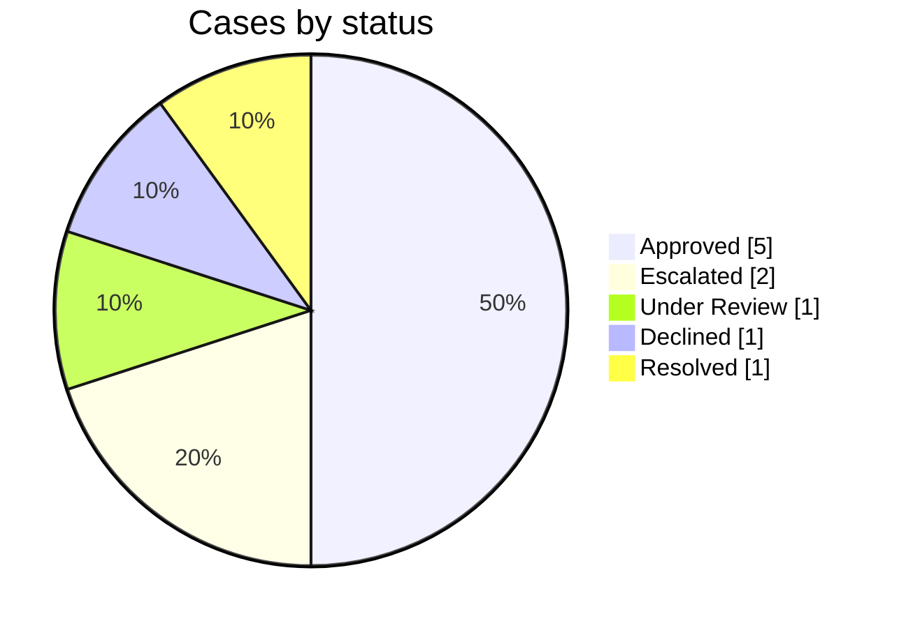
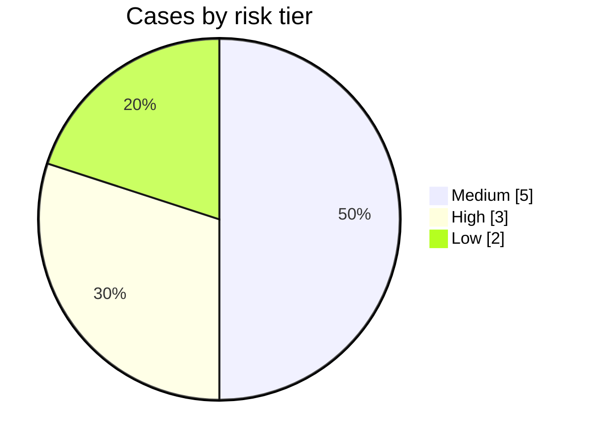
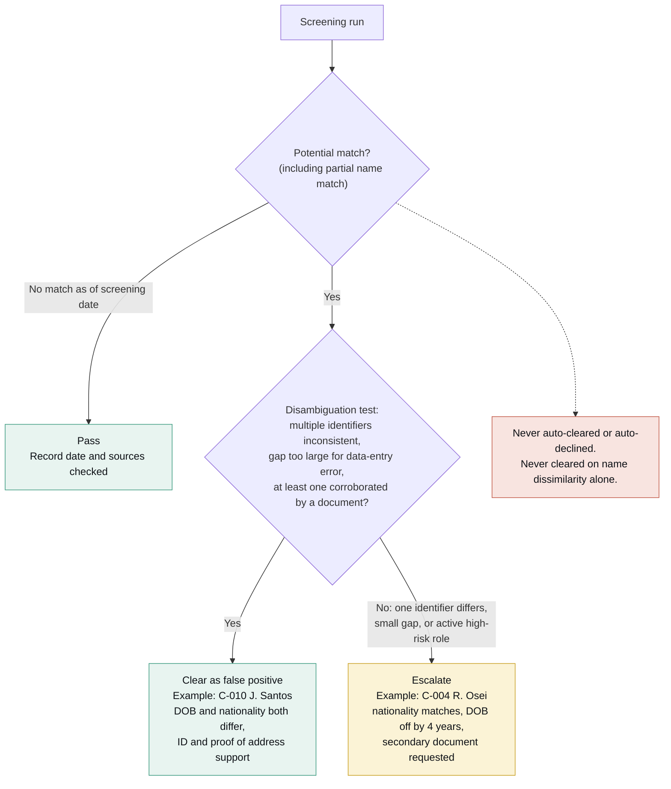
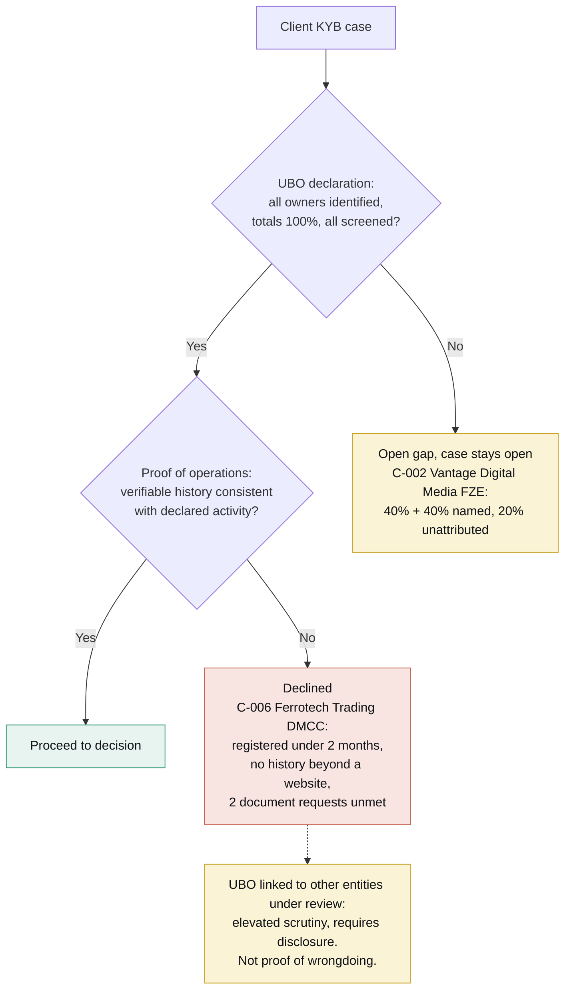
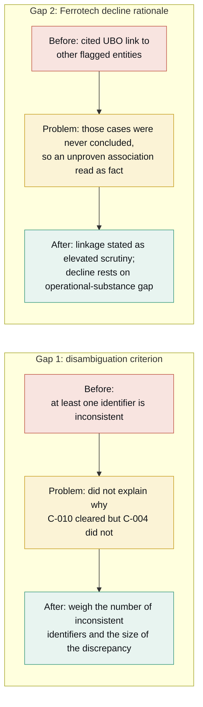

# Aldenbrook Pay: KYB/KYC & Sanctions Casework Register

> **Not real data.** Aldenbrook Pay is a fictional platform built to demonstrate evidence-first KYB, KYC, and sanctions/PEP/adverse-media casework.

**Core principle:** an unresolved screening flag is not a confirmed match; "no adverse media found" is not "confirmed clean"; and missing documentation is an open gap that blocks a decision, not evidence of low risk.

---

## 1. Project map

How the web page and the workbook fit together.

---

## 2. Case portfolio (10 cases)

| Case type | Cases |
|---|---|
| Client KYB | C-001, C-002, C-006, C-009 |
| Contractor KYC | C-003, C-004, C-007, C-010 |
| Payment Investigation | C-005, C-008 |

---

## 3. Screening decision flow (sanctions / PEP)

Why C-004 was escalated and C-010 was cleared.

---

## 4. KYB evidence gaps (ownership and operations)

How open gaps block or drive a decision.

---

## 5. The four worked cases at a glance

| Case | Subject | Issue | Handling | Outcome |
|---|---|---|---|---|
| C-002 | Vantage Digital Media FZE | 20% of ownership unattributed | Recorded as an open gap, not a benign omission | Under Review |
| C-004 | R. Osei | Partial PEP match, DOB differs by 4 years | Escalated; one small discrepancy against an active high-risk role is not enough to rule out the match | Escalated |
| C-006 | Ferrotech Trading DMCC | Recent registration, no operational history | Declined mainly on the operational-substance gap; UBO linkage treated as elevated scrutiny only | Declined |
| C-010 | J. Santos | Sanctions name match | Cleared only after two identifiers plus a document contradicted the listed record | Approved |

---

## 6. Self-review: two gaps found and fixed

Neither was a factual error. Both were places where the stated standard and the actual decision did not quite line up.

---

## Suggested walkthrough order

1. **Frame it** (not real data, then the core principle)
2. **Project map** (section 1): what is on the page vs. in the workbook
3. **Portfolio** (section 2): 10 cases, status and risk mix
4. **Screening flow** (section 3): C-010 cleared vs. C-004 escalated
5. **KYB gaps** (section 4): C-002 open gap, C-006 declined
6. **Self-review** (section 6): what was caught and fixed
